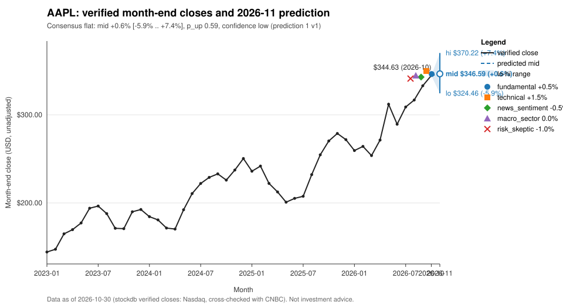

# AAPL: prediction for 2026-11

## Summary
Consensus call: **flat**, mid +0.6% (range -5.9% to +7.4%), p_up 0.59, confidence 0.14 (low).
In price terms, from the verified 2026-10 close of $344.63, the consensus band is $324.46 to $370.22 with a mid of $346.59.
The deterministic baseline leans up on strong price momentum. Four of the five accepted analyzers call flat, because the only company-specific news in the pack is negative: owners reported cracks in the first foldable iPhone Duo [S37] and Apple said it would replace affected handsets [S40]. The pack has no verified research notes or filings, so confidence stays low.

## Baseline vs Consensus
| | Direction | Low | Mid | High | p_up | Confidence |
|---|---|---|---|---|---|---|
| Baseline (deterministic) | up | -5.2% | +1.2% | +8.1% | 0.57 | 0.211 |
| Consensus (accepted analyses) | flat | -5.9% | +0.6% | +7.4% | 0.59 | 0.14 |

The overlay was not clamped (overlay_clamped false) and the band was not clamped either. The analyzer overlay pulls the baseline mid down from +1.2% to +0.6%, and the direction moves from up to flat.

## Analyzer Views
| Analyzer | Direction | Low | High | Confidence |
|---|---|---|---|---|
| fundamental | flat | -5.0% | +6.0% | 0.25 |
| technical | up | -4.0% | +7.0% | 0.35 |
| news_sentiment | flat | -5.0% | +4.0% | 0.30 |
| macro_sector | flat | -5.0% | +5.0% | 0.25 |
| risk_skeptic | flat | -8.0% | +6.0% | 0.30 |

- fundamental: <!-- opinion:fundamental -->The pack has no notes, filings or IR sources, so no verified catalyst is available. The iPhone Duo quality issue suggests possible replacement costs and some reputational drag but cannot be quantified. That offsets part of the baseline drift and gives a flat call with low confidence.<!-- /opinion --> [S37] [S40]
- technical: <!-- opinion:technical -->The trend is clearly up: four consecutive higher month-end closes, the October close at the one-year high, positive momentum at every horizon and strong outperformance against peers. Conviction is held back by the extension at the high, by mean-reversion risk and by a weak peer tape. The result is a modest up view.<!-- /opinion -->
- news_sentiment: <!-- opinion:news_sentiment -->All company news covers a single negative story, iPhone Duo screens cracking. It is corroborated across outlets but softened by the replacement remedy. AAPL still finished October higher, so much of the story looks absorbed. The call is flat with a slight downside skew.<!-- /opinion --> [S37] [S40] [S39] [S58]
- macro_sector: <!-- opinion:macro_sector -->The verified macro news is geopolitical and gives no signal on rates or inflation. Both mega-cap peers are falling while AAPL rises. That gap could mean a defensive rotation into AAPL or a divergence that closes, and it is treated as a headwind that offsets the baseline's mild upward tilt.<!-- /opinion -->
- risk_skeptic: <!-- opinion:risk_skeptic -->The baseline edge is thin, and momentum and mean-reversion point opposite ways. The run is stretched at a one-year high, and the history shows sharp one-month pullbacks after strong runs. Peer de-rating could spread to AAPL. The foldable defect story came late in the month and may not be fully priced in. The call is flat with a downside-skewed range.<!-- /opinion --> [S37] [S40] [S39] [S58]

## Bull & Bear Case
Bull: <!-- opinion:technical -->Momentum is positive at every horizon, the October close is a one-year high and AAPL has clearly outperformed its peers. If the momentum regime persists, the upper part of the range is reachable.<!-- /opinion --> The baseline p_up is 0.57 and the consensus p_up is 0.59. The replacement program limits the damage from the foldable defect [S40].
Bear: <!-- opinion:risk_skeptic -->The price is extended after a strong multi-month run, and a normal-sized drawdown has room to happen. GOOGL and AMZN weakness could catch up with AAPL.<!-- /opinion --> Coverage of cracked iPhone Duo screens [S37] [S58] could broaden into demand or margin concerns.

## Risks
<!-- opinion:risk_skeptic -->The strongest counter-arguments are reversal risk after a stretched run that ended at a one-year high, and a sector-wide de-rating that pulls AAPL toward its falling mega-cap peers. Product tail risk from the iPhone Duo screen cracks and the replacement program adds to this. Independent coverage of that story is narrower than it looks, because two of the four reports come from the same outlet. The stories appeared shortly before month-end, so any demand or margin impact may not be priced in. The pack has no research notes and no fundamental catalyst to offset these risks.<!-- /opinion --> [S37] [S39] [S40] [S58]

## What Would Change the Call
- A November return above +7.4% (the consensus high) would show the momentum regime is still in control and invalidate the flat call; a return below -5.9% (the consensus low) would point to a downside break.
- Verified follow-up coverage showing that the iPhone Duo crack issue stays limited to the replacement program [S40], with no sales or recall impact, would turn the news into a stale catalyst and tilt the call toward the baseline's up direction.
- A verified recall or a guidance cut tied to the foldable would strengthen the downside skew.
- A strong November rebound in GOOGL and AMZN would remove the peer-divergence risk.

## References
- [S37] iPhone Duo owners report cracks in Apple's first foldable handset, guardian, 2026-10-26, https://theguardian.com/technology/2026/oct/26/iphone-duo-owners-cracks-apple-first-foldable-handset (corroborated, sha256:6772ea8f)
- [S39] Apple's new foldable iPhone hits a snag, cbs, 2026-10-27, https://cbsnews.com/video/apples-new-foldable-iphone-hits-a-snag (verified, sha256:8b838e09)
- [S40] iPhone Duo: Apple to replace handsets affected by screen issues, bbc, 2026-10-27, https://bbc.co.uk/news/articles/c893zwlev2xpo (verified, sha256:305470af)
- [S58] iPhone Duo owners say Apple's new foldable phone broke within hours of purchase, cbs, 2026-10-28, https://cbsnews.com/news/iphone-duo-owners-report-cracked-screens-apple-foldable (verified, sha256:dd35ee73)

## Data As Of
Verified month-end close $344.63 on 2026-10-30 (as-of month 2026-10); pack_id 5, run_id 1; baseline-v1, k 1.1; consensus-v1.
News and research notes dated after 2026-10-30 are excluded (as-of discipline).

## Disclaimer
This report is an automated statistical and research summary, not investment advice.
