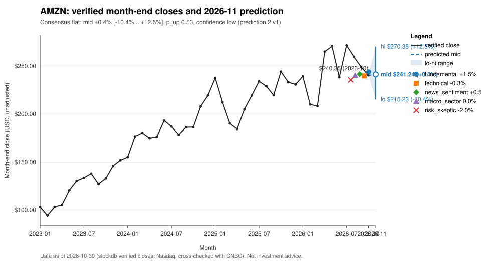

# AMZN: prediction for 2026-11

## Summary
Consensus call: **flat**, mid +0.4% (range -10.4% to +12.5%), p_up 0.53, confidence 0.08 (low).
From the verified close of $240.35 this range spans $215.23 to $270.38, with a mid of $241.24. The verified third-quarter release [S53] is supportive, with AWS growth and Q4 guidance, but net income fell year over year. Recent month-end closes have also trended lower. The accepted analyzers split between a mild up lean, flat and a mild down lean, so the consensus stays close to the flat deterministic baseline and confidence is low.

## Baseline vs Consensus
| | Direction | Low | Mid | High | p_up | Confidence |
|---|---|---|---|---|---|---|
| Baseline (deterministic) | flat | -10.1% | +0.7% | +12.8% | 0.52 | 0.133 |
| Consensus (accepted analyses) | flat | -10.4% | +0.4% | +12.5% | 0.53 | 0.08 |

The analyzer overlay was not clamped (overlay_clamped false), and the band was not clamped either (band_clamped false). The consensus mid sits slightly below the baseline anchor because the down-leaning risk_skeptic view offsets the up-leaning fundamental view.

## Analyzer Views
| Analyzer | Direction | Low | High | Confidence |
|---|---|---|---|---|
| fundamental | up | -4.0% | +7.0% | 0.35 |
| macro_sector | flat | -7.0% | +7.0% | 0.25 |
| news_sentiment | flat | -6.0% | +7.0% | 0.10 |
| risk_skeptic | down | -12.0% | +8.0% | 0.20 |
| technical | flat | -7.0% | +6.5% | 0.30 |

- fundamental: <!-- opinion:fundamental -->Strong AWS growth and a Q4 guide whose upper end implies faster growth support a modest positive tilt. Lower net income and the lack of a verified November catalyst keep the range narrow and close to the baseline. Confidence is moderate (0.35) because the evidence comes from a single source.<!-- /opinion --> [S53]
- macro_sector: <!-- opinion:macro_sector -->The verified macro news in the pack is geopolitical and has no stated link to rates, inflation or sector rotation, so it does not move the view. Peer returns show dispersion within mega-cap tech, not a uniform sector move. With no macro tilt in either direction the view defers to the flat baseline, with low confidence (0.25).<!-- /opinion -->
- news_sentiment: <!-- opinion:news_sentiment -->The pack holds no verified company-scope news for AMZN in the window, so there is no news balance to measure. The view is neutral, with a range bracketing zero inside the baseline band and minimal confidence (0.10).<!-- /opinion -->
- risk_skeptic: <!-- opinion:risk_skeptic -->The baseline's slight upward tilt relies on long-run drift, while the recent trend, relative strength against peers and the drop in net income all point lower. The earnings reaction is already in the October close and there is no independent corroboration. That supports a mild down lean with a wide, skewed range and low confidence (0.20).<!-- /opinion --> [S53]
- technical: <!-- opinion:technical -->Three consecutive lower month-end closes and negative but modest momentum z-scores point to a mild downtrend, not a breakdown. Last month AMZN held up better than the peer average. The signals do not clearly favour either direction, so the call is flat, with a range slightly narrower than the baseline band and low-moderate confidence (0.30).<!-- /opinion -->

## Bull & Bear Case
Bull: The third-quarter release reports higher net sales, strong AWS segment growth and Q4 net sales guidance above the prior-year level [S53]. AMZN also beat the peer average in the latest month. <!-- opinion:fundamental -->Growth that matches or exceeds the guide could lift the return toward the top of the fundamental range (+7.0%).<!-- /opinion -->

Bear: Net income fell year over year [S53], and month-end closes have declined for three months in a row since the 2026-07 high. <!-- opinion:risk_skeptic -->Weak relative strength and possible spillover from a sharp peer drawdown could push the return toward the low end of the skeptic range (-12.0%).<!-- /opinion -->

## Risks
<!-- opinion:risk_skeptic -->The main counter-argument is that the baseline's mild upward drift is out of step with the negative recent trend. A sector-level drawdown in a large-cap peer could spill over into AMZN. The only company evidence is one primary source, with no independent corroboration and no verified company news, so post-earnings drift is unknown. The skeptic range is wide and skewed to the downside (-12.0% to +8.0%).<!-- /opinion --> [S53]

Additional model risk: the consensus confidence is low (0.08), and the consensus band (-10.4% to +12.5%) reflects ordinary monthly volatility. Outcomes outside the band remain plausible.

## What Would Change the Call
- A November month-end close back above the verified 2026-09 month-end close would show that the post-earnings downtrend has broken, which would favour an up call (risk_skeptic invalidation condition).
- A close below $215.23 (the consensus low) would point to a down move larger than the band allows, consistent with sector spillover risk.
- A rebound in the large-cap tech peers after the October drawdown, if it lifts AMZN with them, would undercut the skeptic's down lean.
- A verified source reporting upward revisions driven by AWS growth, or a cut to the Q4 guidance in [S53], would shift the fundamental tilt.

## References
- [S53] Amazon.com announces third quarter results, ir-amzn, 2026-10-29, https://aboutamazon.com/news/company-news/amazon-earnings-q3-2026-report (verified, sha256:eb70c331)

## Data As Of
Verified month-end close 240.35 on 2026-10-30 (as-of month 2026-10); pack_id 4, run_id 1; baseline-v1, k 1.1; consensus-v1.
News and research notes dated after 2026-10-31 are excluded (as-of discipline).

## Disclaimer
This report is an automated statistical and research summary, not investment advice.
