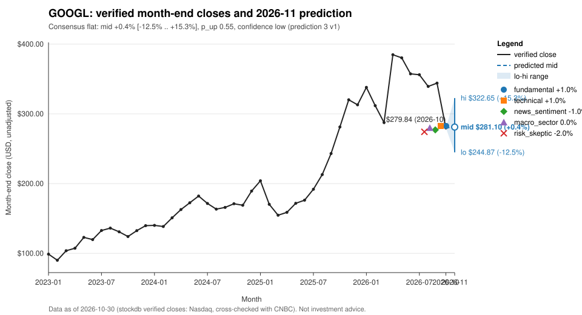

# GOOGL: prediction for 2026-11

## Summary
Consensus call: **flat**, mid +0.4% (range -12.5% to +15.3%), p_up 0.55, confidence 0.09 (low).
In price terms, measured from the verified October close of $279.84, that is a mid of $281.10 and a range of $244.87 to $322.65.
All five accepted analyzers call flat. Strong Q3 results in Alphabet's own release [S62] are weighed against a sharp October selloff, which the BBC links to concern that Google's AI search is hurting ad sales [S60]. Confidence is low because the analyzers agree only on a flat direction and the verified evidence is thin.

## Baseline vs Consensus
| | Direction | Low | Mid | High | p_up | Confidence |
|---|---|---|---|---|---|---|
| Baseline (deterministic) | flat | -11.8% | +1.2% | +16.0% | 0.55 | 0.178 |
| Consensus (accepted analyses) | flat | -12.5% | +0.4% | +15.3% | 0.55 | 0.09 |

The overlay was not clamped (overlay_clamped false, band_clamped false). The analyzer overlay moves the mid down slightly from the baseline anchor and leaves p_up unchanged. The baseline is available (status ok, reproducible), so this is not a short-history ticker.

## Analyzer Views
| Analyzer | Direction | Low | High | Confidence |
|---|---|---|---|---|
| fundamental | flat | -6.0% | +8.0% | 0.35 |
| technical | flat | -8.0% | +10.0% | 0.30 |
| news_sentiment | flat | -8.0% | +6.0% | 0.25 |
| macro_sector | flat | -8.0% | +8.0% | 0.25 |
| risk_skeptic | flat | -16.0% | +12.0% | 0.25 |

- fundamental: <!-- opinion:fundamental -->Strong Q3 growth in revenue, operating margin and Google Cloud, set against an unresolved concern that AI search is cannibalising ads and against equity-issuance and debt-funding overhang. Stays near the baseline with a slight positive tilt for valuation support after the selloff.<!-- /opinion --> [S62] [S63] [S60]
- technical: <!-- opinion:technical -->A sharp breakdown and the deepest drawdown from the high in the window. Negative momentum conflicts with historical mean reversion after a move of this size, and elevated volatility calls for a wide range. Flat, centred slightly positive.<!-- /opinion -->
- news_sentiment: <!-- opinion:news_sentiment -->The verified company news is negative but thin: each item comes from a single outlet with no corroboration. Both items were published before the as-of close, so they look largely priced in, but they offer no catalyst for a rebound either. Flat with a slight negative skew.<!-- /opinion --> [S60] [S61]
- macro_sector: <!-- opinion:macro_sector -->The verified macro news is geopolitical and political and gives no signal on rates or sector rotation, so no macro tilt is applied. GOOGL's weakness relative to its peers looks specific to the company. Defers to the baseline.<!-- /opinion -->
- risk_skeptic: <!-- opinion:risk_skeptic -->The rebound case is weaker than the baseline assumes. The October drop looks like an earnings-reaction gap tied to a thesis-level concern about ads. The fundamental support comes only from Alphabet's own filings, and the financing points to potential dilution. Widens the range and skews it down.<!-- /opinion --> [S60] [S61] [S62] [S63]

## Bull & Bear Case
Bull: <!-- opinion:fundamental -->Reported Q3 growth is strong across revenue, Cloud, net income and EPS, which may support valuation after the selloff.<!-- /opinion --> [S62] <!-- opinion:technical -->Sharp monthly drops earlier in the verified series were followed by rebounds, and the baseline's mean-reversion component leans up.<!-- /opinion -->

Bear: <!-- opinion:risk_skeptic -->The BBC ties the loss in market value to AI search hurting ad sales. A concern at the thesis level can keep dragging on the stock for weeks. Remaining at-the-market issuance capacity and a senior notes offering point to heavy capex funding and potential dilution.<!-- /opinion --> [S60] [S62] [S63]

## Risks
<!-- opinion:risk_skeptic -->The risk_skeptic's main points are these. The mean-reversion bias in the baseline may overstate the rebound, because GOOGL-specific weakness persists over several horizons while AAPL held up. The fundamental notes come only from Alphabet's own filings, and the Q3 figures were already known when the market sold off. Both news items lack independent corroboration, and the CBS headline mixes in an unrelated Binance-hack story. High volatility implies wide outcomes in either direction.<!-- /opinion --> [S60] [S61] [S62] [S63]

Limitations: the stored company evidence for this call comes only from SEC filings ([S62] Alphabet's Q3 earnings exhibit and [S63] an 8-K) and two news items ([S60], [S61]), each from a single outlet with no independent corroboration. Independent bearish coverage could not be verified, so the pack holds no independent bearish analysis. The verified macro news in the pack is geopolitical and political and gives no economic signal. One pending company news item was excluded and is not used.

## What Would Change the Call
- A November return above the risk_skeptic's range high of +12.0% would mean mean reversion is stronger than the skeptical view allows. A full retracement to the verified September close would be a separate, stronger scenario.
- A November return below the risk_skeptic's range low of -16.0%, for example after verified evidence of further deterioration in ad revenue or new ATM share issuance.
- A November close outside the consensus range ($244.87 to $322.65) would fall outside this call.
- Verified, independently corroborated coverage showing the AI-search ad concern was overdone, or a verified guidance change reported by a primary source.

## References
- [S60] Google value plunges by $500bn as its own AI search hits ad sales, bbc, 2026-10-29, https://bbc.co.uk/news/articles/cm9qzdqpxy48o (verified, sha256:8f834b5a)
- [S61] Google parent Alphabet sees massive stock plunge; shockwaves after Binance hack, cbs, 2026-10-30, https://cbsnews.com/video/google-parent-alphabet-sees-massive-stock-plunge-shockwaves-after-binance-hack (verified, sha256:e82f7a2d)
- [S62] Document, sec, undated, https://sec.gov/Archives/edgar/data/1652044/000165204426000080/googexhibit991q32026.htm (verified, sha256:c19b1fc0)
- [S63] 8-K, sec, undated, https://sec.gov/Archives/edgar/data/1652044/000119312526342390/d171253d8k.htm (verified, sha256:00bbd3d5)

## Data As Of
Verified month-end close 279.84 on 2026-10-30 (as-of month 2026-10); pack_id 3, run_id 1; baseline-v1, k 1.1; consensus-v1.
News and research notes dated after 2026-10-30 are excluded (as-of discipline).

## Disclaimer
This report is an automated statistical and research summary, not investment advice.
