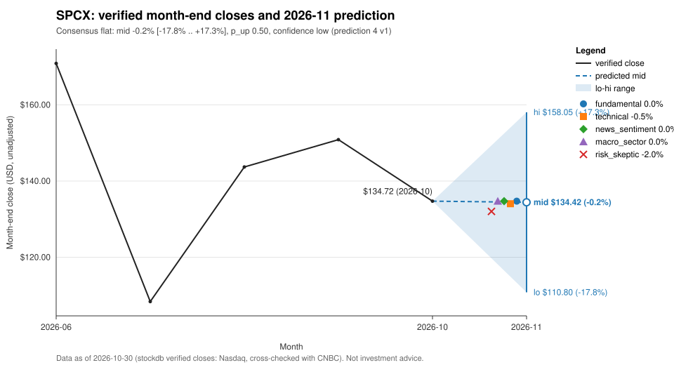

# SPCX: prediction for 2026-11

## Summary
Consensus call: **flat**, mid -0.2% (range -17.8% to +17.3%), p_up 0.50, confidence 0.05 (low).
In price terms, from the verified 2026-10 close of $134.72 the range runs from $110.80 to $158.05, with the mid at $134.42.
Confidence is low because SPCX is a recent listing with only five verified month-end closes. The deterministic baseline is null (short history), there are no peers, and pack 6 holds no company news, research notes or filings. None of the five accepted analyzers found evidence for a direction, so all five called flat with wide ranges. The only verified news in the pack is macro and geopolitical, with no stated link to SPCX.

## Baseline vs Consensus
| | Direction | Low | Mid | High | p_up | Confidence |
|---|---|---|---|---|---|---|
| Baseline (deterministic) | null (short history) | null | null | null | null | null |
| Anchor used (no baseline) | flat | -16.5% | 0.0% | +16.5% | 0.50 | 0 |
| Consensus (accepted analyses) | flat | -17.8% | -0.2% | +17.3% | 0.50 | 0.05 |

Baseline: null (short history). Because there is no baseline, the consensus is anchored on the server's neutral no-baseline anchor shown above. The overlay was not clamped (overlay_clamped false), and the band was not clamped (band_clamped false). Every accepted view is flat, so analyzer agreement adds no directional signal.

## Analyzer Views
| Analyzer | Direction | Low | High | Confidence |
|---|---|---|---|---|
| fundamental | flat | -15.0% | +15.0% | 0.15 |
| technical | flat | -18.0% | +17.0% | 0.15 |
| news_sentiment | flat | -20.0% | +20.0% | 0.10 |
| macro_sector | flat | -18.0% | +18.0% | 0.15 |
| risk_skeptic | flat | -20.0% | +16.0% | 0.15 |

- fundamental: <!-- opinion:fundamental -->Pack 6 contains no research notes, company news, filings or IR sources, and no verified catalyst for the target month. The CIK is null and the peers list is empty. With no fundamental signal, the view is flat with a wide symmetric range and low confidence.<!-- /opinion -->
- technical: <!-- opinion:technical -->The momentum signals disagree. The one-month return is negative (the October pullback), while the three-month return is positive (the recovery from the July low). The close is still below the first verified close. There is no reliable trend or mean-reversion signal.<!-- /opinion -->
- news_sentiment: <!-- opinion:news_sentiment -->There is no company-scope news and there are no research notes. The verified macro items are geopolitical and have no stated link to SPCX or aerospace. With no news signal, the view defaults to flat with a wide symmetric range and minimal confidence.<!-- /opinion -->
- macro_sector: <!-- opinion:macro_sector -->None of the macro items covers rates, inflation, growth or sector rotation. The peers list is empty, so there is no peer or benchmark signal. The view takes no directional stance and uses a wide symmetric range.<!-- /opinion -->
- risk_skeptic: <!-- opinion:risk_skeptic -->With no anchor call and no base case to argue against, the view is flat. The range is skewed to the downside because the latest month was negative and the post-listing drop has not been fully recovered.<!-- /opinion -->

## Bull & Bear Case
The verified closes are 170.86 (2026-06), 108.37 (2026-07), 143.69 (2026-08), 150.86 (2026-09) and 134.72 (2026-10).

Bull: <!-- opinion:technical -->The positive three-month return reflects a recovery from the July low, with two consecutive up months before October.<!-- /opinion --> No verified source supports a company-specific upside catalyst.

Bear: <!-- opinion:risk_skeptic -->The latest month was negative, and the October close is still below the first post-listing close.<!-- /opinion --> No verified source supports a company-specific downside catalyst either.

The verified macro items in the pack cover topics such as the Brazil election [S41] and the Jordan/Syria strikes [S49]. They have no stated link to SPCX and are not used as evidence for the call.

## Risks
<!-- opinion:risk_skeptic -->Realized volatility may be higher than this range allows: the July drop and the August rebound were each larger than the skeptic's band. The view assumes there is no verified company catalyst in the target month, such as a filing, earnings, a launch or contract news. A broad market drawdown or rally could pull SPCX with it, and there is no benchmark or peer data to measure that exposure.<!-- /opinion -->
The short history is the main structural risk. With only five verified closes, volatility, momentum and up-rate statistics cannot be estimated, and the baseline is null.

## What Would Change the Call
- A verified 2026-11 month-end close below $110.80 or above $158.05, which would fall outside the consensus range of -17.8% to +17.3%.
- A verified company-specific source dated in 2026-11 (an SEC filing, earnings, guidance, a launch or contract news) that points to a sustained directional driver.
- A large broad-market drawdown or rally reported by verified sources. SPCX's market exposure cannot be measured without peer or benchmark data.
- Enough verified history for the deterministic baseline to become non-null and replace the neutral anchor.

## References
- [S41] Brazil's left-wing President Lula elected for fourth term, npr, 2026-10-26, https://npr.org/2026/10/25/nx-s1-6016299/brazil-lula-bolsonaro-election (verified, sha256:f8c3854d)
- [S49] Jordan launches airstrikes in Syria after church attack, france24, 2026-10-27, https://france24.com/en/jordan-launches-airstrikes-in-syria-after-church-attack (verified, sha256:a52c2d00)

## Data As Of
Verified month-end close 134.72 on 2026-10-30 (as-of month 2026-10); pack_id 6, run_id 1; consensus-v1; baseline null (short_history).
News and research notes dated after 2026-10-30 are excluded (as-of discipline).

## Disclaimer
This report is an automated statistical and research summary, not investment advice.
